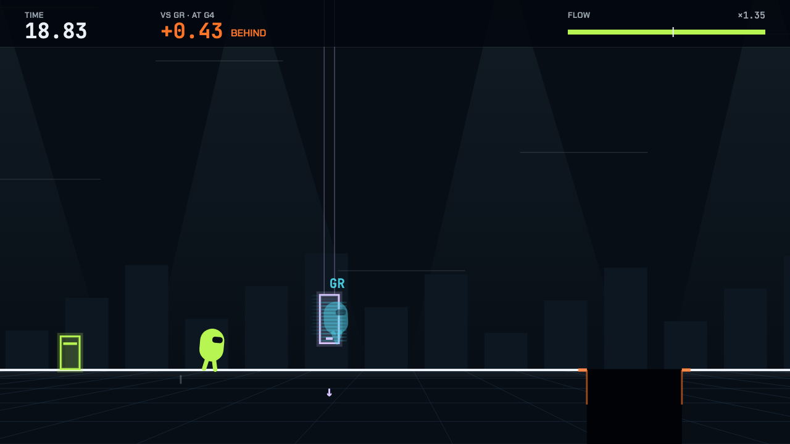
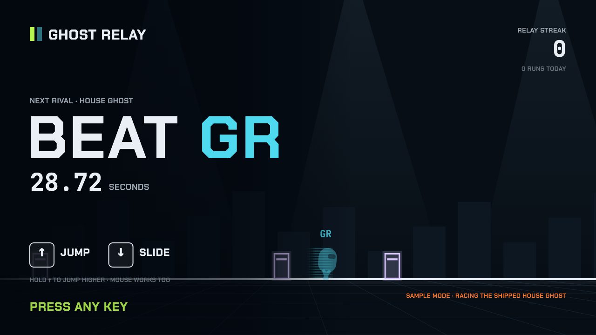
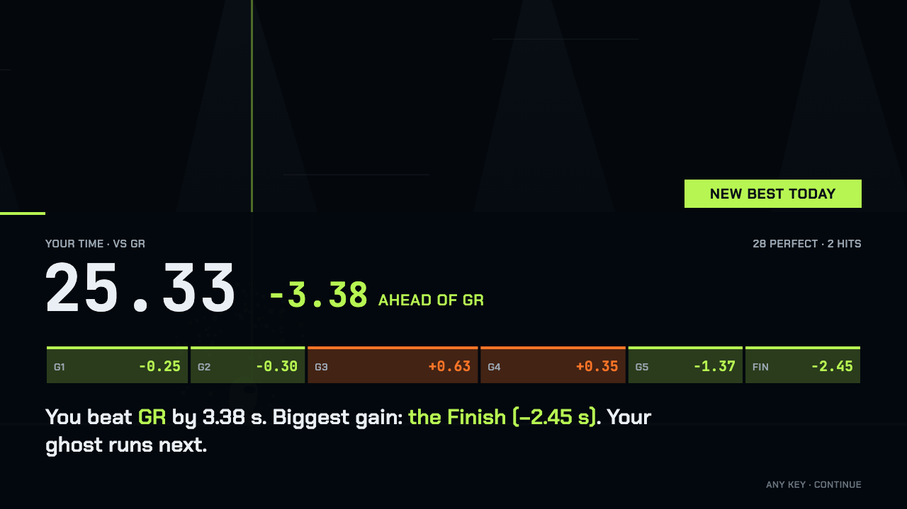
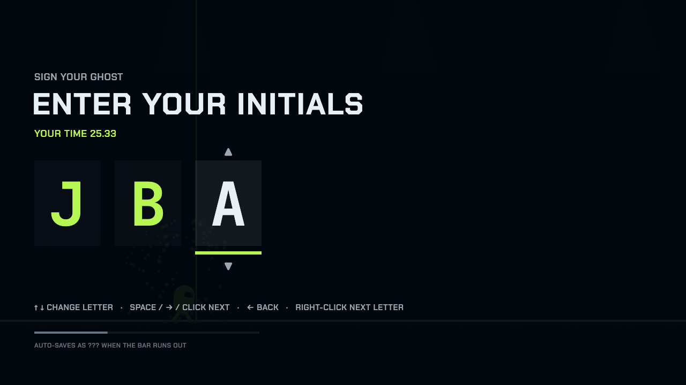
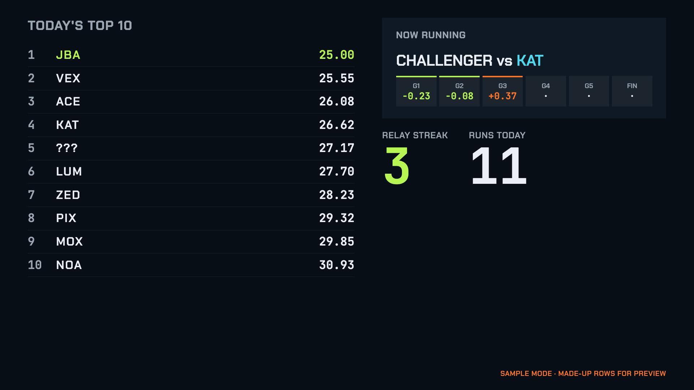

# Ghost Relay

> A 30-second neon sprint where you race the ghost of the player who went right before you. Two buttons, no tutorial, no internet.

Built for **Cloud9 x JetBrains: Sky's The Limit 2026**, Category 3 (Event Mini Game).

[Official rules](https://cloud9.devpost.com/rules) · [Category submission specifics](https://cloud9.devpost.com/details/submission-specifics)



## The problem

A booth volunteer has a queue of strangers and one laptop. A high-score table means nothing to the person in line: the number at the top was set three hours ago by someone who left. What they actually watched was the player in front of them. Booth games also tend to fail the volunteer: stuck screens, a tutorial nobody reads, a leaderboard that needs Wi-Fi.

## What it does

- **Race the last player.** Every Run is raced against a translucent Ghost of the previous player's Run. Your Run becomes the Ghost for the next person in line (the Relay).
- **Two buttons.** Jump (↑ / W / Space / left click; hold to go higher) and Slide (↓ / S / right click; fast-fall in the air). Hurdles, Low Bars, Pits and Switch Beams that only reveal jump-or-slide a split second before you reach them.
- **Learn where you lost.** Six Split Gates. A Delta chip pops above each gate as you cross it; the Results screen shows a six-segment split bar and one plain sentence, e.g. *"You lost 0.42 s at Gate 3: 2 hits on the Switch Beam."*
- **Booth-ready.** Attract Mode, arcade Initials, idle timeouts on every screen, champion mode (hold ↓ + press ↑ on Attract), a hidden Operator Panel (`Ctrl+Shift+O`), and a live leaderboard for a second monitor that syncs with no network.

| Attract | Results |
|---|---|
|  |  |
| **Initials** | **Leaderboard Monitor** (`?sample=1` preview rows) |
|  |  |

## The demo moment

In an illustrative turn, Player B finishes just behind Player A's Ghost. The split bar lights G3 orange and Results reads *"You lost 0.42 s at Gate 3: 2 hits on the Switch Beam."* B signs their Ghost, and the next player can use that split to work out where to gain time against B. The gate Deltas fill in live on the second monitor.

## How it works

```
keyboard / mouse ──▶ live mask ──(sampled once per 60 Hz Tick)──▶ Input Log [[tick, mask], ...]
                                                     │
                                                     ▼
                         src/sim  (pure, integer fixed-point ×256, no clocks, no floats in state)
                         step(sim, mask) → runner, obstacles, Flow, Split Gates, gate hashes
                                                     │
      Ghost = same sim, same Course, inputs replayed ─┤  gate hash mismatch → Ghost rejected
                                                     ▼
              canvas renderer (interpolated) · WebAudio synth · booth state machine · localStorage
                                                     │
                                       BroadcastChannel + storage events
                                                     ▼
                                     leaderboard.html (second monitor)
```

- A Ghost is **not** a recording of positions. It is the player's Input Log (typically under 1.3 KB) re-simulated through the same deterministic sim, stepped on the same Tick as the player ([ADR 0001](docs/adr/0001-ghost-is-a-resimulated-input-log.md), [ADR 0002](docs/adr/0002-integer-fixed-point-simulation.md)).
- Every Switch Beam has one authored answer for the whole relay. Its reveal still depends on position; reaching it on a different Tick never changes its answer.
- Each Ghost stores a state hash at every Split Gate. A replay that drifts is rejected and the rival falls back to the next Ghost, then the House Ghost.
- The **Course Version** is a hash of the Course data and every tuning constant, so changing physics automatically retires old Ghosts.
- `src/sim/` imports nothing outside itself; a test greps it for `Math.random`, `Date`, `performance`, DOM globals and trig.

## Sponsor tech & why it is necessary

- **JetBrains Mono** (OFL, bundled via `@fontsource/jetbrains-mono`) sets every time and Delta with tabular digits, so numbers never jitter while the timer runs.
- **JetBrains tooling:** Category 3 requires using at least one eligible JetBrains development tool. Rider is recommended. The tooling explanation is pending the owner's account of what they used.
- No Cloud9 or Riot assets are used; the game is original art drawn in canvas.

## Quickstart

The hosted demo is pending GitHub Pages deployment. Use the local build below to play.

Requires Node 22.12 or later in the Node 22 series.

```bash
npm ci
npm run dev          # http://localhost:5173  (game)  ·  http://localhost:5173/leaderboard.html
```

Booth (offline, production build):

```bash
npm ci               # once, while online
npm run booth        # builds and serves http://localhost:4173
```

1. Player monitor: open `http://localhost:4173/?booth=1`, press F11 (cursor hidden, reload shortcuts blocked).
2. Second monitor: open `http://localhost:4173/leaderboard.html` in a second window in the same browser profile and press F11. Keep the player page visible during a Run.
3. Start of day: `Ctrl+Shift+O` → *Start new day* → Enter twice. `Esc` closes the panel.
4. The monitor reports whether the player station is connected, hidden, or absent. Use its **Open player station** link or **Refresh monitor** button to recover.
5. To recover, exit full screen and use the browser toolbar to reload. Completed Runs are saved locally. A Run still in progress is discarded.

Other scripts: `npm test`, `npm run typecheck`, `npm run build`, `npm run house-ghost` (regenerate the shipped House Ghost).

## Sample mode vs live mode

There is no API key or account anywhere in this project, so "live" simply means real players on the booth laptop.

| | What you see |
|---|---|
| **Sample mode (zero config)** | On a fresh browser there are no Runs yet, so the first player races the shipped **House Ghost** (`src/game/houseGhost.json`, generated by a scripted autopilot, 28.72 s). Attract shows `SAMPLE MODE · RACING THE SHIPPED HOUSE GHOST` until someone finishes a Run. |
| **Screenshot scenes** | `?scene=attract`, `?scene=run`, `?scene=results`, `?scene=initials` freeze a deterministic frame (an autopilot racing the House Ghost) using in-memory storage only. |
| **Leaderboard preview** | `leaderboard.html?sample=1` shows made-up rows, labelled `SAMPLE MODE · MADE-UP ROWS FOR PREVIEW`; it never reads or writes the real board. |
| **Live** | Every completed Run is saved to localStorage and becomes the next player's Ghost. The second monitor restores live splits from localStorage when opened or refreshed, and listens for BroadcastChannel and storage events. |

## Judging criteria → where to see proof

| Criterion | Proof |
|---|---|
| Technological implementation | Integer fixed-point sim in [`src/sim/`](src/sim/); replay verification by gate hashes ([`src/game/ghost.ts`](src/game/ghost.ts)); tests below; offline two-window sync ([`src/booth/broadcast.ts`](src/booth/broadcast.ts), [`src/leaderboard/main.ts`](src/leaderboard/main.ts)); WebAudio synth with zero audio files ([`src/audio/synth.ts`](src/audio/synth.ts)) |
| Design | Two buttons, no tutorial; Verdict sentence ([`src/booth/verdict.ts`](src/booth/verdict.ts)); split bar; Night broadcast palette ([`src/game/render/theme.ts`](src/game/render/theme.ts)); Deltas always carry a sign and a word, never colour alone; `prefers-reduced-motion` disables shake and speed lines |
| Potential impact | Attract Mode, idle timeouts on every screen ([`src/booth/stateMachine.ts`](src/booth/stateMachine.ts)), Operator Panel, offline leaderboard monitor, Booth setup above |
| Quality of idea | You race the person who just played, and the game tells you exactly where you lost to them ([ADR 0003](docs/adr/0003-default-ghost-is-previous-player.md)) |
| Presentation | Screenshots above; video script in [`docs/SPEC.md`](docs/SPEC.md#13-video-script--3-min) |

### Test results (verified on 2026-11-21)

```
jump peaks: tap 49.3 px, full hold 82.5 px
flat: 2000/2000 replays matched; largest log 343 bytes
full: 2000/2000 replays matched; largest log 1236 bytes
endurance: 1000 turns, mean run 31.41 s, 40/40 stored ghosts replay-verified, 499496 bytes stored, listeners 1
Test Files  16 passed (16)
Tests  69 passed (69)
```

The production build also passed two complete turns in headless Chromium with keyboard-only and mouse-only input. A second window recovered live splits after reloading with BroadcastChannel disabled. Both pages loaded from local build files under the Pages subpath.

Autopilot measurements (from `npm run house-ghost`): an error-free expert autopilot finishes in 22.67 s with 0 hits; the House Ghost, which deliberately fumbles three Switch Beams and hits two Double Hurdles, finishes in 28.72 s.

## Project structure

```
src/sim/          pure deterministic simulation: course, runner physics, obstacles, Flow, splits, hashing, autopilot
src/booth/        state machine, timers, storage, rival selection, verdict, initials, broadcast
src/game/         loop, input, App orchestrator, renderers (world, runner, ghost, HUD, fx, background), screens, scenes
src/audio/        WebAudio synth
src/leaderboard/  second-monitor page (DOM)
scripts/          House Ghost generator (autopilot → JSON)
test/             determinism, obstacles, purity, splits, ghost, state machine, storage, rival, verdict, endurance
docs/             SPEC, PLAN, GRILL, RESEARCH, ADRs, METHODOLOGY template, images
```

## Storage recovery and accessible controls

The game labels the lime runner **YOU** and the cyan runner with its rival name. The opening screen explains the starter ghost, and Results explains that this run becomes the next rival. Tab reaches the spectator link and Operator button without starting a run; screen readers receive state announcements. Reduced motion removes ambient pulses and reveals as well as camera effects.

If localStorage is denied or fills during play, the current tab keeps its relay in memory and shows **SESSION ONLY**. Export runs from Operator before closing the tab. This fallback does not persist across reloads and cannot sync a spectator window. Existing incompatible Course Versions are excluded from best-time comparisons and spectator ranks.

## Known limitations

- **Not playtested with real people yet.** Tuning (hitbox forgiveness, Pit width 110 px, Double Hurdle spacing 170 px) comes from autopilot measurements; the SPEC tables were updated to the measured values. Expected human times are unverified.
- The expert autopilot is 22.67 s, just under the 23–26 s target in the plan.
- **Pending on the booth hardware:** a two-monitor run with Wi-Fi off, frame budget, and WebAudio node growth over many Turns. The GitHub Pages deployment is also pending.
- The finish slow-motion and the Flow-following synth drone from SPEC §5.1 are not implemented; speed lines and shake are.
- Kiosk mode can only block some browser shortcuts (F11 / Esc are still the browser's).
- The ESLint `no-restricted-globals` rule from SPEC §7 is not set up; sim purity is enforced by the Vitest grep only.
- Canvas colours use `oklch()` strings, which need a current Chrome, Edge, Safari or Firefox.

## How this was built

This prototype was built with significant AI assistance: the planning documents (spec, grill, ADRs, plan) and the implementation in this repository were drafted by an AI coding agent working from the owner's brief, and are reviewed by the author. All test numbers above come from actual test runs. The owner's own JetBrains tooling workflow (WebStorm, Junie) will be described in [`AI_SHOWCASE.md`](AI_SHOWCASE.md) and [`docs/METHODOLOGY.md`](docs/METHODOLOGY.md); those files are templates until the owner writes them from real use.

## License

[MIT](LICENSE). Fonts bundled via Fontsource under the SIL Open Font License 1.1. [Chakra Petch license](public/licenses/Chakra-Petch-OFL.txt) · [JetBrains Mono license](public/licenses/JetBrains-Mono-OFL.txt)
